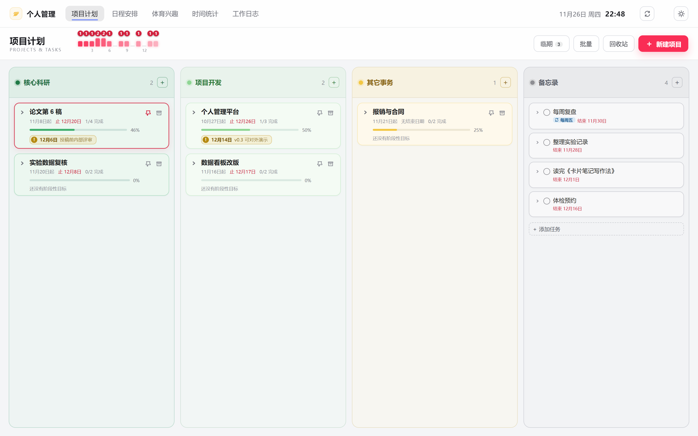
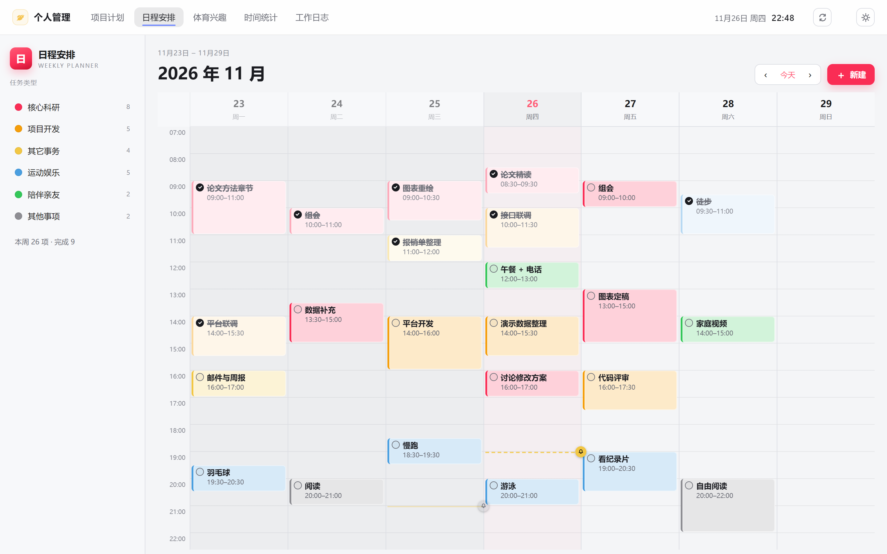
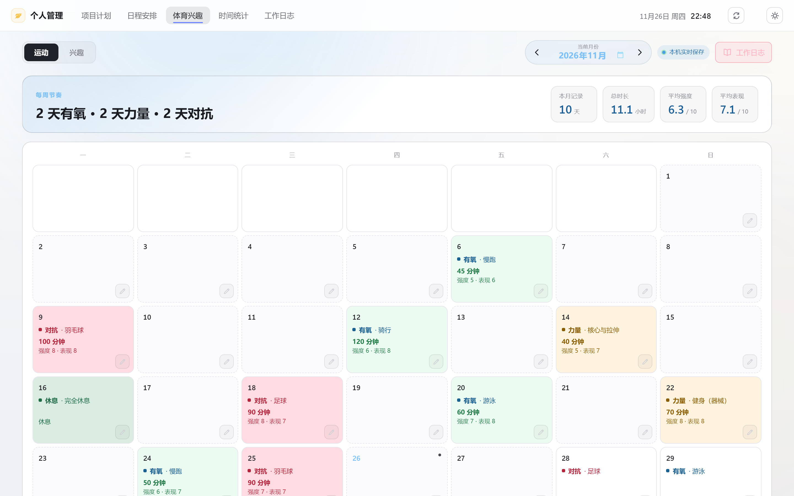
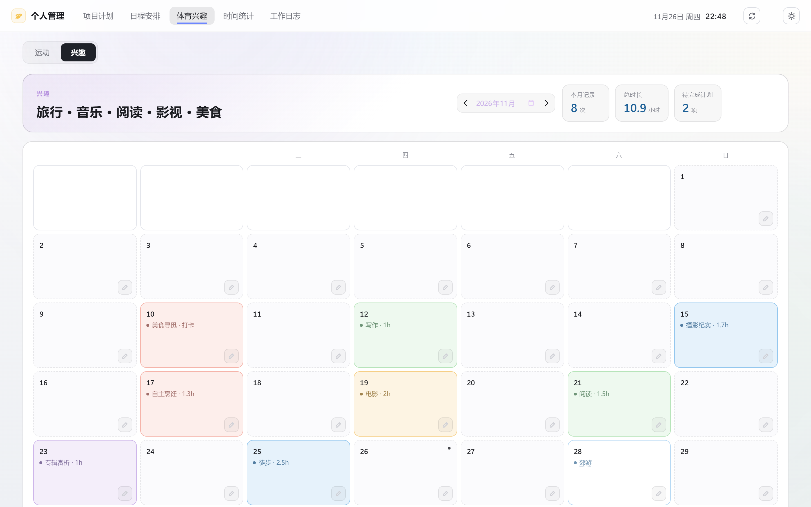
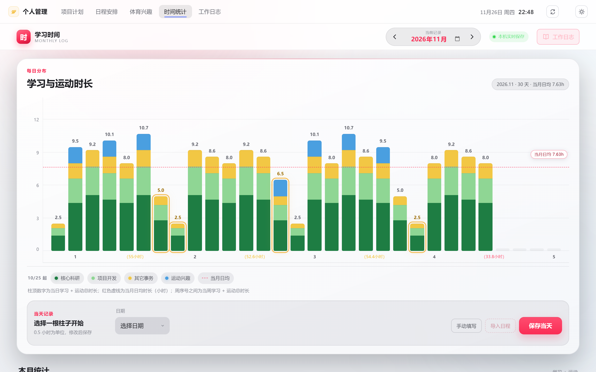

# 个人管理 · Personal Management Hub

把「任务规划」和「时间管理」收进一个入口的本地软件。五个页面共用一套数据，全部跑在自己电脑上。



它不是又一个待办 App，而是给「一个人 + 多个智能体」这种工作方式准备的操作台。

---

## 为什么做这个

**Agent 时代，每个人都应该拥有自己的专属软件。**

过去二十年，我们把自己切成几块去适配软件：任务放 Todoist，日程放日历，习惯放打卡 App，时间统计放 RescueTime。软件是通用的，人被迫去迁就它的字段和流程。

当写代码、查资料、跑实验都能交给智能体之后，这件事反过来了：软件应该长成**你的**样子。你的项目分类、你的周节奏、你对「今天算不算过得好」的定义，都该直接长在工具里，而不是塞进别人的模板。

这件事的第一步很小：**把所有任务规划与时间管理的入口合成一个**。

然后是第二步：这些入口背后不再是死数据，而是能被智能体读取、补全、执行的项目。你写下「论文第 6 稿」，智能体知道该去哪几个文件夹找材料；你记下「周三 19:00 羽毛球」，它知道那段时间不该排会。

这个仓库是第一步的成品，也是第二步的底座。

---

## 五个页面

### 项目计划 · 想清楚要做什么

四列看板：核心科研、项目开发、其它事务、备忘录。

三层结构：**项目 → 任务 → 事项**。项目用所属分类的颜色涂满，任务区保持中性；每个任务下面挂若干可以勾掉的小事，进度按任务一票一票算出来。

顶栏上有一条十四格的到期条：每一格是未来的一天，柱子越高说明那天要收尾的事越多，柱下在第 3、6、9、12 天标了小数字方便定位。点一下柱顶的数字，能看到那天到底是谁的项目在逼近。

**周期只说明这件事要持续多久，截止日期才是那个必须赶上的日子。**

### 日程安排 · 一天是怎么过的

周一到周日的时间网格，只显示 07:00 到次日 01:00。分时段是色块，颜色就是你的六类事务；时间点上的提醒不占位置，只画一条横线，线尾挂一个小铃铛，鼠标放上去看内容，点开能改。

过去的周保留下来，只读，不会再被自动清掉——想回看上周干了什么，它还在。



### 体育兴趣 · 身体和喜欢的事

上半张是运动：有氧、力量、对抗、休息四类，格子按类型着色，记录时段、强度、表现。下半张是兴趣：旅行、音乐、阅读、影视、美食，只记时长，默认 2 小时，也可以只打卡不计时。

运动和兴趣加起来才是生活，但它们不该混进「工作时间」里。





### 时间统计 · 时间去哪了

按月看每天的时间去向：四类时长的堆叠柱、当月日均虚线、有效记录日、单日最高。

运动记录的总时长会自动折进当天的「运动」一栏，不用重复填。想让某一天的数据和日程对齐，点「导入日程」——它只统计当天**已经勾选完成**的分时段事项，按颜色归到对应的四类里。



### 工作日志 · 一天留下了什么

按天整理：一段不超过 100 字的总摘要，加上当天各个项目的进展卡片。

内容由智能体从会话记录里提炼成 JSON，页面只负责展示。写的时候不用想着排版，读的时候一眼能看完。


手机宽度下顶栏收成两行，五个页签横向排满，日程和日历照样能用。


---

## 关于隐私

这个项目从第一天就是**单机、单用户、无账号**的。

- 数据只存在本机的一个文件里，不上传、不同步、不打点；
- 没有登录、没有云端，断网照常工作；
- 仓库里的截图和演示数据**全部是编的**：项目名、日志正文、时间分布都是脚本生成的示例，不对应任何真实的人或事；
- 仓库不包含任何真实数据库文件。`.gitignore` 会挡掉 `*.db` 和日志正文，只留一份虚构的日志样例用来看排版。

想更保险，clone 之后第一件事就是把 `static/journals/` 里的示例删掉，从头开始记自己的。

---

## 跑起来看看

需要 Python 3.10 以上。

```bash
git clone https://github.com/chenshi0504/personal-management-hub.git
cd personal-management-hub
pip install -r requirements.txt

# 先生成一份演示数据，界面立刻有内容
python demo_seed.py
python app.py
```

打开 <http://127.0.0.1:8012>，会落到日程安排。

想用自己的库：把 `demo.db` 删掉，直接 `python app.py`，它会自己建一份空的。端口和数据位置都能改：

```bash
PORT=9000 STUDY_DB=~/data/my-life.db python app.py
```

Windows 上双击 `start.bat` 也行。

演示数据全是虚构的，看完删掉 `demo.db` 就干净了。

---

## 一些设计取舍

**为什么不做成云服务。** 这些数据（每天几点在干什么、身体状态、读书记录）比大多数账号密码私密。本地跑意味着没有中间人，也意味着断网时它照常工作。

**为什么日程不自动清理。** 早期的版本每周一清掉上一周，用久了发现：回看上周是常事，而且清掉之后就再也说不清「那天到底做了什么」。现在它只增不删，过去的周只读。

**为什么兴趣只记时长。** 兴趣不是 KPI。记录「这周听了两张专辑」比记录「专辑赏析：完成度 80%」更接近事实。

**为什么计划不自动排。** 模板排出来的计划只会被无视。空白格子是提醒你自己决定，而不是让系统替你决定。

**为什么提醒只占一条线。** 提醒没有时长，给它一个方块，等于在日历上谎报了一段时间。

---

## 已知限制

- 单人单机，没有多用户与权限；
- 时区固定 `Asia/Shanghai`；
- 工作日志正文靠外部生成，页面本身不做编辑；
- 周视图在 07:00–01:00 之外不显示，也不支持拖拽改时间；
- 桌面壳（Electron 包装）不在仓库里，想要独立窗口可以自己套一层，页面不用改。

---

## 许可

MIT。拿去改成自己的样子就好，这也是它存在的意义。
