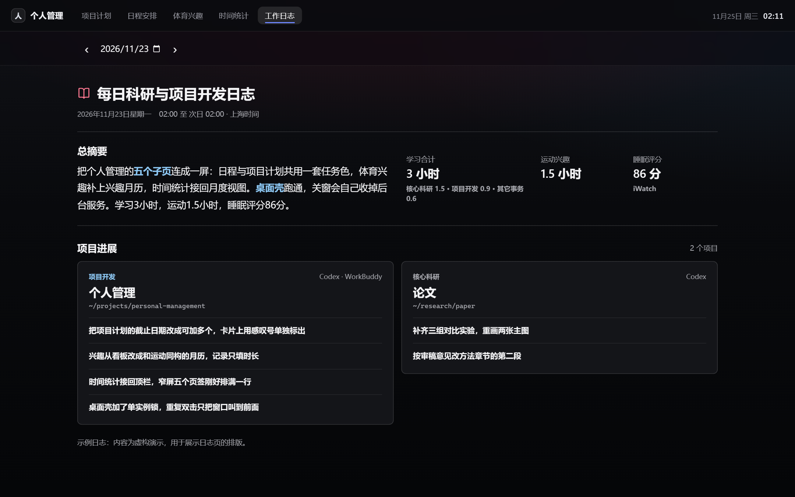
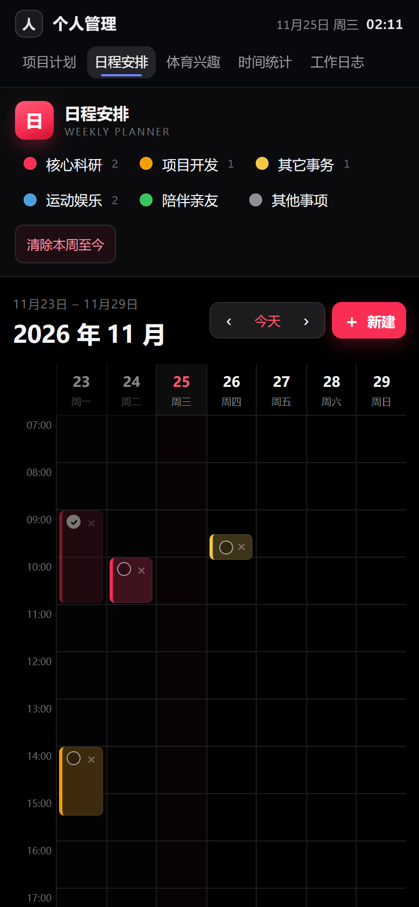

# 个人管理 · Personal Management Hub

把「任务规划」和「时间管理」收进一个入口的本地软件：项目计划、日程安排、体育兴趣、时间统计、工作日志五页并排，数据存在本机一个 SQLite 文件里。

它不是又一个待办 App，而是给「一个人 + 多个智能体」这种工作方式准备的操作台。

---

## 为什么做这个

**Agent 时代，每个人都应该拥有自己的专属软件。**

过去二十年，我们把自己切成几块去适配软件：任务放 Todoist，日程放日历，习惯放打卡 App，时间统计放 RescueTime。软件是通用的，人被迫去迁就它的字段和流程。

当写代码、查资料、跑实验都能交给智能体之后，这件事反过来了：软件应该长成**你的**样子。你的项目分类、你的周节奏、你对「今天算不算过得好」的定义，都该直接长在工具里，而不是塞进别人的模板。

这件事的第一步很小：**把所有任务规划与时间管理的入口合成一个**。

然后是第二步：这些入口背后不再是死数据，而是能被智能体读取、补全、执行的项目。你写下「论文第 6 稿」，智能体知道该去哪几个文件夹找材料；你记下「周三 19:00 羽毛球」，它知道那段时间不该排会。

这个仓库是第一步的成品，也是第二步的底座。

---

## 界面

五个页面共用一个顶栏，左上角是「个人管理」，右侧是精确到分钟的日期时间，默认落在日程安排。

### 日程安排

周一到周日的时间网格，只显示 07:00 到次日 01:00；分时段是色块，提醒是时间点的小条。每周一自动清掉上一周。


### 项目计划

四列看板：核心科研、项目开发、其它事务、备忘录。项目用所属分类的颜色涂满，任务区是中性的；一个项目可以挂多个截止日期，用感叹号单独标出——**周期只表示持续多久，截止日期才是那个必须赶上的日子**。


### 体育兴趣

和运动同一套日历。上半张是运动：有氧、力量、对抗、休息四类，格子按类型着色，记录时段、强度、表现。下半张是兴趣：旅行、音乐、阅读、影视、美食，只记时长，默认 2 小时，也可以只打卡不计时。


### 时间统计

按月看每天的时间去向：四类时长的堆叠柱、当月日均虚线、有效学习日、单日最高。训练记录的总时长会自动折进当天的「运动」一栏，不用重复填。


### 工作日志

按天整理：一段不超过 100 字的总摘要，加上当天各个项目的进展卡片。内容由智能体从会话记录里提炼成 JSON，页面只负责展示。



手机宽度下顶栏收成两行，五个页签横向排满，日程和周视图照样能用。



---

## 快速开始

需要 Python 3.10 以上。

```bash
git clone <this-repo>
cd personal-management-hub
python -m venv .venv
# Windows
.venv\Scripts\activate
# macOS / Linux
source .venv/bin/activate

pip install -r requirements.txt
python app.py
```

打开 <http://127.0.0.1:8012>，会自动跳到日程安排。端口和数据库位置都能用环境变量改：

```bash
PORT=9000 STUDY_DB=~/data/my-life.db python app.py
```

Windows 双击 `start.bat` 也行，它会自己建虚拟环境装依赖。

### 先看看长什么样

想直接看有数据的界面，先生成一份演示库：

```bash
# Windows
set STUDY_DB=demo.db && python demo_seed.py
set STUDY_DB=demo.db && set PORT=8099 && python app.py

# macOS / Linux
STUDY_DB=demo.db python demo_seed.py
STUDY_DB=demo.db PORT=8099 python app.py
```

演示数据全是虚构的，看完把 `demo.db` 删掉即可。

---

## 数据放在哪

只有一个 SQLite 文件（默认 `study-time.db`，和 `app.py` 同目录），没有账号、没有云同步、没有埋点。

- 备份就是复制这个文件；
- 想换机器，连同文件一起拷走；
- 想清空重来，删掉它，下次启动会重新建表。

工作日志的正文是 `static/journals/<date>.json`，一天一个文件，纯文本，可以直接用编辑器改。

---

## 一些设计取舍

**为什么不做成 Web 服务挂在云上。** 这些数据（每天几点在干什么、身体状态、读书记录）比大多数账号密码私密。本地跑意味着没有中间人，也意味着断网时它照常工作。

**为什么日程要每周自动清理。** 过去的周留着会让人反复回看、反复修改，实际没什么用。清掉之后，日历只回答一个问题：这周还剩几天。

**为什么兴趣只记时长。** 兴趣不是 KPI。记录「这周听了两张专辑」比记录「专辑赏析：完成度 80%」更接近事实。

**为什么计划不自动排。** 模板排出来的计划只会被无视。空白格子是提醒你自己决定，而不是让系统替你决定。

---

## 已知限制

- 单人单机，没有多用户与权限；
- 日程的时区固定为 `Asia/Shanghai`；
- 工作日志的正文靠外部生成，仓库里只带一份示例，页面本身不做编辑；
- 周视图在 07:00–01:00 之外的时间不显示，也不支持拖拽改时间；
- 桌面壳（Electron 包装）没有放进仓库，需要独立窗口可以自己用 Electron 或 Tauri 套一层，页面不需要改。

---

## 许可

MIT。拿去改成自己的样子就好，这也是它存在的意义。
